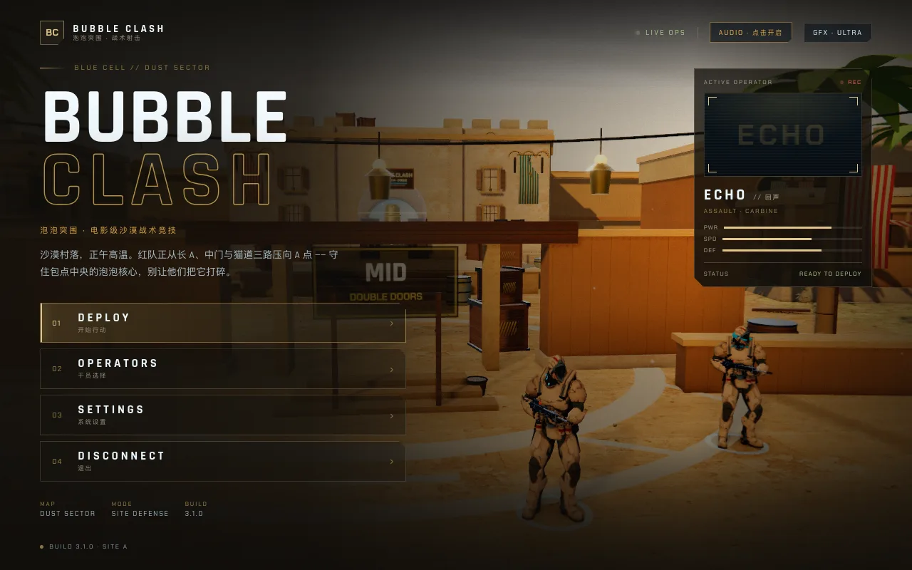
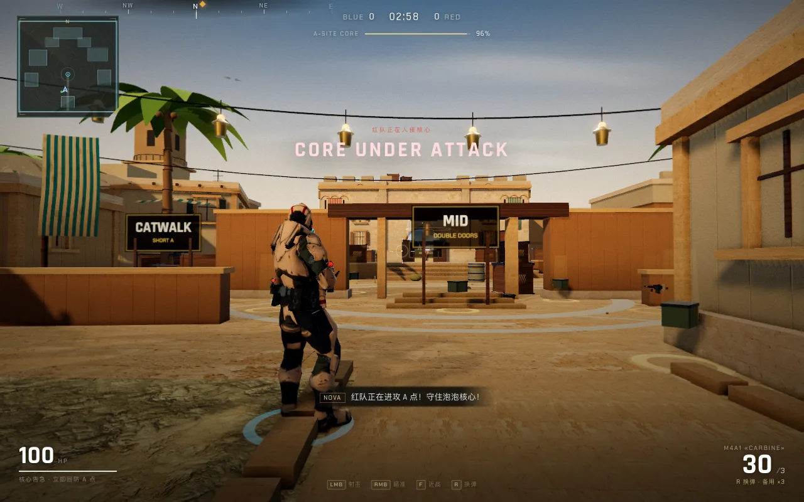
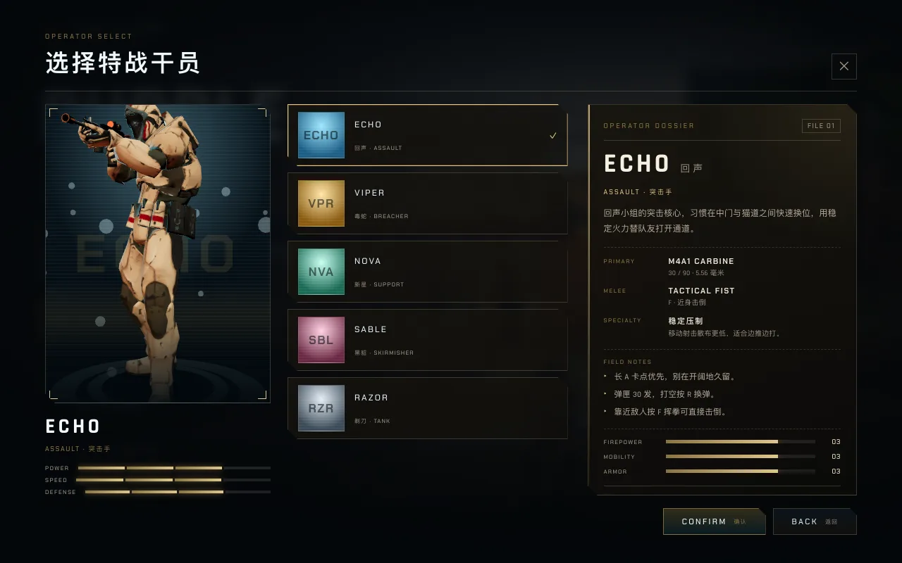

<p align="center">
  
</p>

<h1 align="center">Bubble Clash · 泡泡突围</h1>

<p align="center">
  基于 Three.js 的浏览器第三人称战术射击游戏<br/>
  守卫沙漠村落 A 点的泡泡核心，击退红队的三路进攻
</p>

<p align="center">
  
  
  
  
</p>

---

## 目录

- [项目简介](#项目简介)
- [游戏截图](#游戏截图)
- [核心特性](#核心特性)
- [快速开始](#快速开始)
- [操作方式](#操作方式)
- [玩法说明](#玩法说明)
- [技术栈](#技术栈)
- [项目结构](#项目结构)
- [实现亮点](#实现亮点)
- [部署](#部署)
- [已知限制](#已知限制)
- [第三方资源与致谢](#第三方资源与致谢)
- [版权说明](#版权说明)

## 项目简介

**Bubble Clash** 是一款完全运行在浏览器中的第三人称战术射击游戏，无需下载、无需账号，打开页面即可进入战场。

玩家将扮演 BLUE CELL 特战干员，在沙漠村落中守住 A 点的泡泡核心。红队会从长 A、中门与猫道三路推进，持续攻击核心；核心完整度归零则任务失败。

项目使用 Three.js 构建实时 3D 场景，地图、角色、AI、音频与 HUD 全部由前端代码驱动，没有后端依赖。

## 游戏截图

| 战斗场景 | 干员档案 |
| :---: | :---: |
|  |  |

## 核心特性

- **第三人称越肩射击**：腰射 / ADS 瞄准、弹道向准星汇聚、后坐力、换弹、近身格斗。
- **A 点守卫战**：红队从三条路线进攻，核心完整度实时显示，归零即失败。
- **五名可选干员**：ECHO、VIPER、NOVA、SABLE、RAZOR，拥有不同定位、属性与战术档案。
- **战术地图**：致敬 Dust2 的沙漠村落布局，包含 A 点高台、多段楼梯、猫道、长 A、中门与木箱掩体。
- **会思考的 AI**：高度感知 A* 导航、卡死恢复、绕障、上下楼梯、追击、救援与围攻角色分工。
- **程序化音频**：不依赖任何音频文件，菜单 / 战斗音乐、环境声、枪声、脚步、心跳与胜负主题全部实时合成。
- **现代军事 HUD**：罗盘、小地图、目标完整度、击杀提示、伤害方向、连击与命中反馈。
- **性能优化**：几何合并、实例化、粒子池、按需阴影与画质档位，保证浏览器帧率。

## 快速开始

环境要求：Node.js 18+，支持 WebGL2 的现代浏览器（Chrome / Edge / Safari）。

```bash
# 安装依赖
npm install

# 启动开发服务器（Vite 会打印实际端口）
npm run dev

# 生产构建
npm run build

# 本地预览生产构建
npm run preview
```

构建产物输出到 `dist/`，可直接部署为静态网站。

> 浏览器要求先有一次点击才能播放音频。打开页面后点击任意位置，右上角 `AUDIO · 点击开启` 消失即表示音频已激活。

## 操作方式

| 输入 | 动作 | 说明 |
| --- | --- | --- |
| `W A S D` | 移动 | 相对镜头方向移动 |
| `Shift` | 疾跑 | 前进时按住 |
| `Space` | 跳跃 | 可跳上低矮箱体 |
| `鼠标左键` | 射击 | 按住持续开火 |
| `鼠标右键` | 瞄准 | 进入 ADS，降低散布 |
| `F` | 近身格斗 | 贴近敌人挥拳击倒 |
| `R` | 换弹 | 备用弹匣有限 |
| `Esc` | 暂停 | 打开暂停菜单与设置 |

## 玩法说明

1. 从主菜单进入 **DEPLOY**，或先在 **OPERATORS** 中选择干员。
2. 红队会从长 A、中门与猫道持续进攻，优先卡住长 A。
3. 守住 A 点中央的泡泡核心；核心完整度归零则任务失败。
4. 连续命中会累积连击倍率，击杀与近身击倒获得更高分数。
5. A 点周围会刷新 DMR 与 SMG，拾取后获得 30 秒火力优势。
6. 被击倒后会在出生点重新部署，注意别让红队趁机占点。

## 技术栈

| 层 | 技术 |
| --- | --- |
| 渲染 | Three.js r169（WebGL2、PBR、PMREM 环境光、后处理） |
| 构建 | Vite 5 |
| 角色 | Mixamo 动画 + 世界空间重定向，统一不同骨架 |
| AI | 1 米导航网格（带高度采样）+ A* + 卡死检测与局部绕行 |
| 音频 | Web Audio API，程序化合成与总线混音 |
| UI | 原生 HTML / CSS / JavaScript，战术 HUD 与 3D 干员预览 |

## 项目结构

```text
.
├── index.html                  # 页面骨架、HUD、菜单与设置面板
├── src/
│   ├── main.js                 # 入口
│   ├── core/
│   │   ├── engine.js           # 渲染器、相机、画质
│   │   ├── input.js            # 键鼠与指针锁定
│   │   ├── camera.js           # 越肩第三人称相机
│   │   └── assets.js           # HDRI、PBR、模型与动画加载
│   ├── game/
│   │   ├── game.js             # 主循环、状态机、目标与计分
│   │   ├── ai.js               # 导航网格、A*、敌人与队友 AI
│   │   ├── combat.js           # 伤害、射击、近战、复活
│   │   └── projectiles.js      # 弹道与命中检测
│   ├── entities/fighter.js     # 角色模型、装备、武器与动画
│   ├── world/                  # 地图、环境、材质
│   ├── fx/effects.js           # 粒子、曳光、弹孔、爆炸
│   ├── audio/audio.js          # 程序化音乐与音效
│   ├── ui/                     # HUD、菜单、干员预览
│   └── styles/                 # 战术 UI 样式
├── public/
│   ├── assets/
│   │   ├── hdri/               # 4K 沙漠环境光
│   │   ├── textures/           # 2K PBR 贴图
│   │   ├── fonts/              # 界面字体
│   │   └── ui/                 # 设置图标
│   └── models/                 # 角色与 Mixamo 动画
├── package.json
└── vite.config.js
```

## 实现亮点

### 角色与动画

- 使用 `skeletonClone` 克隆骨架，再通过世界空间重定向把 Mixamo 动作套到不同比例的角色上。
- 记录每个模型的朝向修正 `bodyFlip`，复活与重置时保持一致，避免角色转身 180°。
- 武器位置基于手部骨骼与瞄准点动态求解，非瞄准状态沿躯干朝向保持低姿持枪。

### AI 导航

- 导航网格采样每个格子的可站立高度，让楼梯、高台与低矮掩体形成真实的连通关系。
- A* 支持攀爬高度限制与对角通行检查；被挡住时重新寻路，并带卡死检测与侧向脱困。
- 敌人在追击、交火与围攻之间切换，能绕过建筑、爬上 A 点高台并主动接近玩家。

### 音频与反馈

- 菜单与战斗各有一套程序化音乐，强度随附近敌人、核心受损与玩家血量变化。
- 枪声由爆响、火药主体、低频与尾音多层合成；另有弹壳、换弹、爆头、击杀与低血量心跳。
- 受击闪光为琥珀黄，并伴随方向性血雾；弹道使用清晰的暖白曳光。

## 部署

项目是纯静态前端，构建后把 `dist/` 部署到任意静态托管即可。

**Netlify（推荐）**

- Build command：`npm run build`
- Publish directory：`dist`
- 连接 GitHub 仓库后，每次推送自动部署。

**Vercel**

- Framework Preset：Vite
- Build command：`npm run build`
- Output directory：`dist`

**GitHub Pages**

- `vite.config.js` 已设置 `base: './'`，可部署到子路径。
- 将 `dist/` 发布到 Pages（例如通过 GitHub Actions），或把构建产物提交到 Pages 分支。

> 首次加载需要下载约 45 MB 的高清贴图与 4K HDRI，建议使用 Wi-Fi；加载页会显示进度。

## 已知限制

- 目前仅支持键盘 + 鼠标，触屏设备暂未提供虚拟摇杆。
- 界面文案为中文，尚未接入多语言。
- 4K HDRI 与 2K PBR 贴图体积较大，首次进入需要数秒下载。
- 音效与音乐全部实时合成，不同浏览器的音色会略有差异。

## 第三方资源与致谢

- [Three.js](https://threejs.org/) — MIT License
- HDRI 与 PBR 贴图来源于 [Poly Haven](https://polyhaven.com/) 等 CC0 资源库
- 角色模型来自 Three.js 示例与第三方头像资源，动画来自 Mixamo，仅用于非商业演示；商用前请替换或确认授权
- 地图布局参考《反恐精英》Dust2 的 A 点结构，仅作玩法致敬

感谢 Three.js 社区与所有开源素材作者。

## 版权说明

本仓库的代码与游戏设计版权归作者所有，暂未声明开源许可证。  
第三方模型、动画、贴图与 HDRI 的版权归各自原作者所有，使用前请遵守对应许可。
